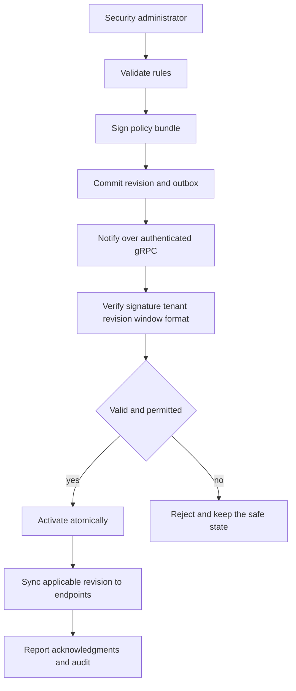

# Zero Trust Cloud & Edge Control Plane

Self-directed reference for a simulated zero-trust policy control plane. An administrator publishes a signed policy. Three edge backends enforce it locally when the cloud path is down. Live PostgreSQL, NATS, Redis, SPIRE, and customer edges are not-run.

Author: Jatinder Singh. License: MIT.

This tree is not a customer deployment and it is not a vendor product. Go is the implementation language requested for the portfolio.

## Measured on this workstation

`go run ./cmd/control-plane bench` on 2026-11-12, go1.26.4, windows/amd64, 11th Gen Intel Core i7-1185G7 (4 cores, 8 logical processors):

| Measurement | Result |
| --- | --- |
| Local authorization, 2000 samples | P50 998 µs, P95 2049 µs, max 10231 µs |
| Publish and sync, 8 samples, 3 edges | P50 29.492 ms, P95 32.199 ms |
| Endpoint records | 300 |
| Price | none |

The proposed targets were local authorization P95 at or below 20 ms and online sync P95 at or below 5 s. This in-process run is under those numbers. It is not a network deployment and it is not a pass gate. The full note is [docs/benchmarks.md](docs/benchmarks.md). The raw report is [reports/bench_results.json](reports/bench_results.json).

`go test -race -count=1 ./...` passed on this workstation before the first commit. The integration test asserts the demo outcomes below.

## Demo outcomes the test asserts

Tenant `SYN-TENANT-CEDAR`. Revision 2 is active on 3 edges. 300 endpoint records acknowledge it. A Cedar read is `permit`. A Birch read of the Cedar policy is `not_found`. A tampered bundle is `signature_invalid`. An older revision is `revision_replayed`. Unauthorized grants are 0. Invalid bundles accepted are 0. Rejected updates are at least 2. A self-approval is `self_approval`. Grant TTL is 300 seconds. Privileged access is `grant_permit` before expiry and `grant_expired` after. A revoke during a partition stays `grant_permit` on the disconnected edge and becomes `grant_revoked` after reconnect. An offline read against a valid policy is `permit`. The same edge returns `policy_expired` after the offline window. Audit rows for those decisions are present after the store recovers (`audit_missing` 0). Price is `none`. The bundle transfer uses at least 2 chunks.

A disconnected edge cannot see a cloud revoke of a still-valid policy. The 5-minute grant and the 30-minute low-risk window are the exposure bound. This design does not provide instant global revocation during a partition.

## Run

Requires Go 1.26.4. From this directory:

```text
go test ./... -count=1 -timeout 180s
go run ./cmd/control-plane demo
go run ./cmd/control-plane bench
```

`demo` and `bench` print JSON. Docker and kubectl are not required. The Makefile wraps the same commands for a machine that has `make`.

`GET /health` is an unauthenticated process probe. With no arguments, each executable listens on localhost and prints that the multi-process stack was not started.

| Executable | Probe port | Local check |
| --- | --- | --- |
| control-plane | 8080 | `demo`, `bench` |
| policy-manager | 8081 | compiles the embedded Rego |
| policy-sync | 8082 | reads chunk and bundle limits |
| edge-backend | 8083 | reads `configs/edge-hq.yaml` |
| endpoint-agent | 8084 | reads the endpoint-record count |
| discovery-worker | 8085 | reads the simulator catalog and rejects any other connector |
| access-broker | 8086 | reads the 5-minute grant TTL |
| audit-service | 8087 | reports that audit is in-process |

`policy-manager` and `audit-service` are additional executables. The proposed tree listed the other six commands. The control-plane lab is the process that publishes, syncs, enforces, grants, discovers, and audits. The other processes do not join a cluster.

## What the lab does



- Revisions are immutable and strictly increasing. A rollback is a new higher signed revision. A lower revision is rejected.
- The edge swaps in a snapshot only after the signature, tenant, revision, window, and Rego checks succeed.
- gRPC uses TLS 1.3 and a SPIFFE URI on the peer certificate. The server binds that identity to the registered edge or endpoint. Request fields do not choose the tenant. SPIRE was not started.
- Open Policy Agent evaluates `policies/access.rego` and `policies/privileged.rego`. Grant expiry is decided in Go.
- The in-memory log redelivers until acknowledged. Consumers treat the same revision and digest as a duplicate.
- Discovery accepts `sim-cmdb` and `sim-app` only. It does not dial the network.
- Endpoint IDs `SYN-EP-001` through `SYN-EP-300` are inventory records. Certificates exist for `SYN-EP-001` and `SYN-EP-002`.

People and sites are synthetic: `SYN-USER-ADA`, `SYN-USER-JULES`, `SYN-USER-KIRAN`, `SYN-USER-BIRCH`, `SYN-EDGE-HQ`, `SYN-EDGE-REGION`, `SYN-EDGE-BRANCH`.

## Gates

`GET /v1/gates` reports integrations that were not executed. An empty variable is `not-run`. A set variable is `blocked`, and the process still does not connect.

| Gate | Status when unset |
| --- | --- |
| postgres | not-run |
| nats-jetstream | not-run |
| redis | not-run |
| spire | not-run |
| oidc-provider | not-run |
| docker-local | not-run |
| kubernetes | not-run |
| terraform-apply | not-run |
| otlp-collector | not-run |
| customer-deployment | not-run |

`db/migrations/001_init.sql` was not applied. `deployments/docker-compose.yml`, the Kubernetes manifest, the Helm chart, and the Terraform output were not applied. Compose image names were not pulled on this workstation. GitHub Actions builds the container with `golang:1.26-bookworm` and `debian:bookworm-slim`. That job is the image proof when it is green. A local image build was not run.

Spans stay in memory. Prometheus metrics are served on `/metrics` from a process registry. No collector was contacted.

## Documents

- [System design](docs/system-design.md)
- [Threat model](docs/threat-model.md)
- [Policy lifecycle](docs/policy-lifecycle.md)
- [API contracts](docs/api-contracts.md)
- [Deployment](docs/deployment.md)
- [Benchmarks](docs/benchmarks.md)
- [Runbooks](docs/runbooks/partition.md)
- [ADRs](docs/adr/001-tested-path.md)

## Tests

`tests/security` covers cross-tenant reads, expired and foreign certificates, unauthorized actions, grant expiry, replay, tampered and unsigned bundles, a 64-byte stream limit, impersonation, revoked identities, cache poisoning, high-risk expiry, and a signed rollback that still rejects an older revision.

`tests/chaos` covers an interrupted activation, endpoint disconnect, reconciliation, duplicate and out-of-order delivery, a lost acknowledgment, a down store and a down log, and a saturated worker pool. The down store and the down log stand in for a PostgreSQL or NATS restart. Those servers were not started.

`tests/integration` runs the demo over HTTP and publishes 20 revisions concurrently. Revisions stay unique.
