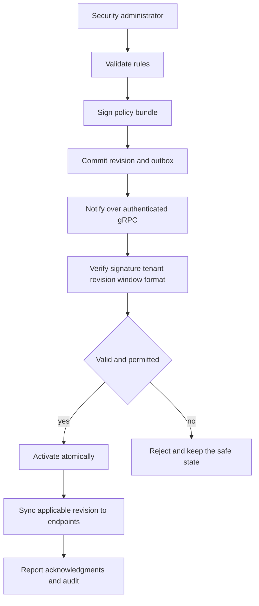

# Policy lifecycle

Lab clock start: `2026-11-11T18:00:00Z`. People: `SYN-USER-ADA` publishes, `SYN-USER-BIRCH` is the other tenant, `SYN-USER-JULES` requests access, `SYN-USER-KIRAN` approves.

## Steps

1. A policy administrator creates or modifies a tenant policy. The platform role creates tenants. A policy administrator cannot approve their own grant.
2. The control plane checks the Rego packages, rejects `default allow := true`, compiles both modules, and rejects a module that allows an empty input. The new revision number is one greater than the latest committed revision.
3. The policy signer produces canonical JSON and an Ed25519 signature over those bytes. The digest is the hex SHA-256 of the same bytes.
4. The store inserts the immutable revision, one pending deployment per tenant edge, and an outbox event `policy.revision.committed` in one commit.
5. Dispatch publishes the outbox row to the in-memory log and then sets `published_at`. If the log is down, the row stays unpublished.
6. Each connected edge subscribes with its certificate. The server sends the latest newer revision. The edge fetches the bundle as chunked envelopes. The default chunk size is 128 bytes, so a real bundle is more than one chunk. The client checks the digest, then `Apply` checks the signature.
7. The edge verifies the signature, the tenant, a positive revision, the Rego, the risk class, the maximum window, and that the lab clock is inside the window. An older revision is rejected even when `rollback` is true. An equal revision with the same digest is a duplicate and does not increment the activation count.
8. The snapshot is swapped in only after those checks. `StageStoppingBeforeActivate` returns `activation_interrupted` and leaves the previous snapshot active. `Recover` reloads a snapshot only when it still verifies and is still inside its window.
9. Connected endpoint records receive the active revision and the acknowledgment is stored. A disconnected endpoint keeps its previous revision.
10. Edge status reports the desired revision, the active revision, lag, and whether the desired deployment is pending or acknowledged. A lost acknowledgment leaves the deployment pending while the edge is already active. A later acknowledgment records the first `acknowledged_at` and supersedes lower pending revisions.

After a partition, the edge subscribes again and activates the latest eligible snapshot. It does not replay every intermediate revision.

## Offline behavior

| Situation | Behavior |
| --- | --- |
| Cloud connection lost | Evaluate explicitly permitted actions against the local policy while it is valid |
| Local policy past `not_after` | Deny new protected access with `policy_expired` |
| Signature invalid or missing | Reject the update |
| Older revision presented | Reject with `revision_replayed` |
| Edge restarts offline | `Recover` installs only a verified, still-valid snapshot |
| Identity cannot be authenticated | Deny |
| Privileged grant expires | Deny later privileged operations with `grant_expired` |
| Cache unavailable | Do not change the decision |
| Central store unavailable | Keep using the locally valid policy; do not publish a new revision |
| Edge reconnects | Activate the latest valid snapshot |

A high-risk window is 5 minutes. A low-risk window is 30 minutes. A bundle whose window is longer than the edge's maximum is `policy_window` and is not activated.

Grant distribution is an in-process snapshot pushed to connected edges. It is not an extra RPC on `PolicySyncService`. The protocol buffer for that service is the one in `proto/policy/v1/sync.proto`.
